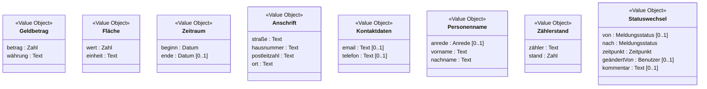
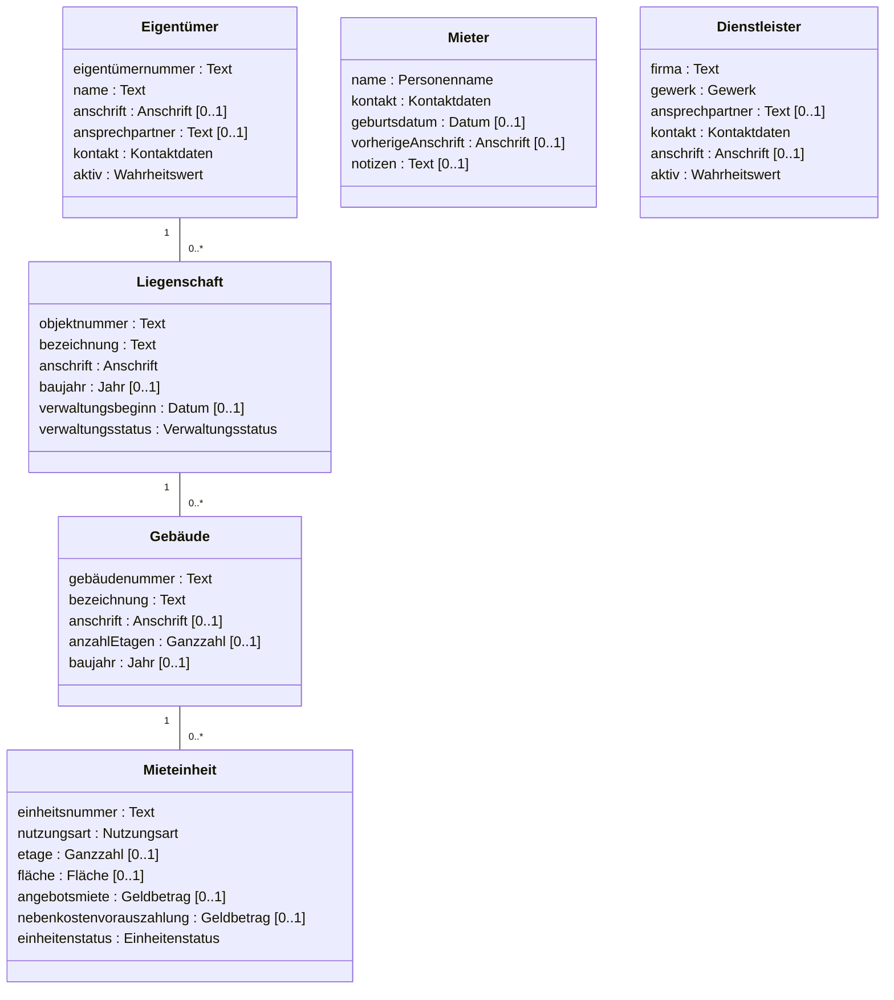
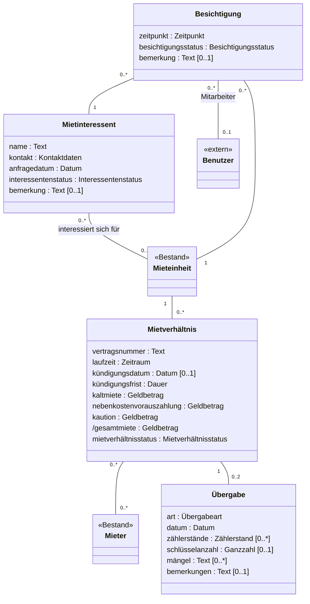
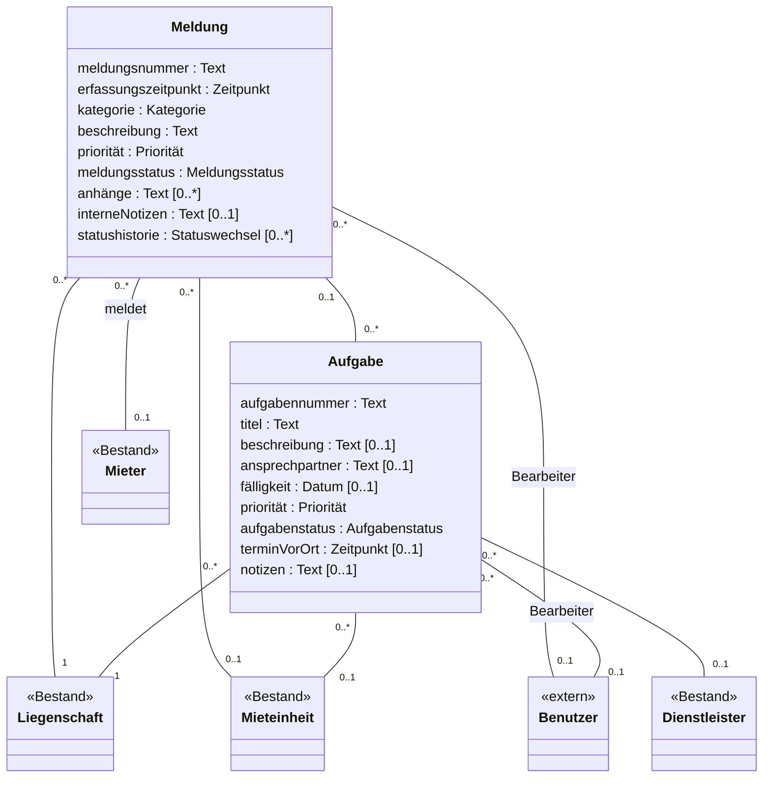
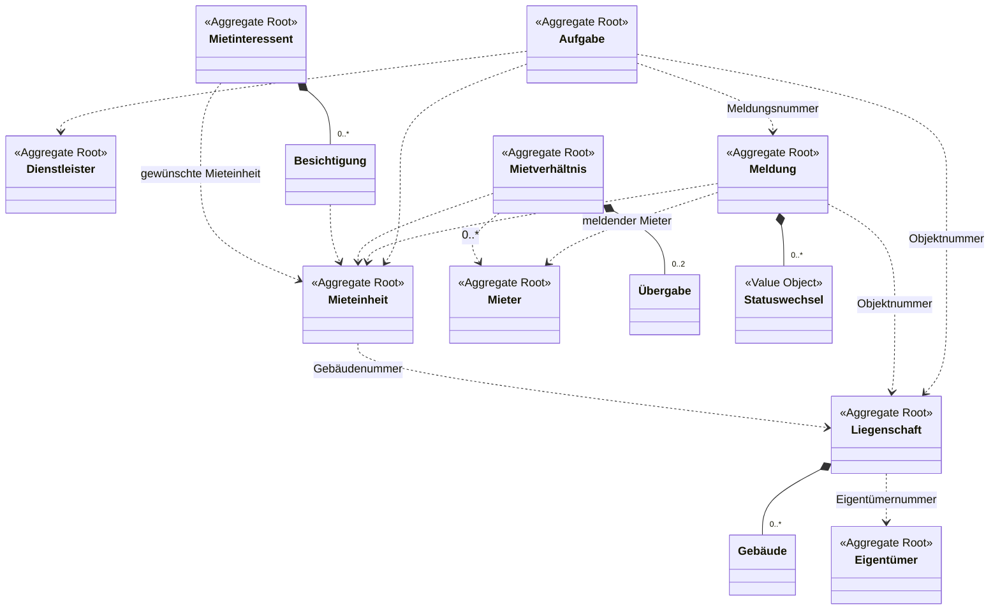

# Fachmodell ImmoVerwalt

Technologieunabhängiges Modell der Pflichtbereiche **Bestand**, **Vermietung** und
**Meldungen und Aufgaben**, abgeleitet aus dem Altsystem: Bausteine (Leitfaden Schritt 5) und
Aggregate (Schritt 8).
Begriffe nach [glossar.md](./glossar.md), Kontexte nach [kontexte.md](./kontexte.md),
Regeln nach [regelkatalog.md](./regelkatalog.md). Entscheidungen und Begründungen stehen im
[Logbuch](./logbuch.md).

Code-Namen (`Tenancy::coldRent`) erscheinen nur in der Spalte *Klasse / Feld (Code)* als
Fundstelle. Im Modell selbst und in den Diagrammen stehen nur fachliche Begriffe.

## Vorgehen

Für jede Klasse und jedes Feld der Pflichtbereiche wurden die drei Fragen aus dem Leitfaden
beantwortet:

1. Ist es technisch (Kennung, Version, Zeitstempel, Anzeigesteuerung)? → **technisch**, weggelassen.
2. Hat es eine eigene Identität, die über Änderungen hinweg gleich bleibt? → **Entity**.
3. Wird es nur durch seine Werte bestimmt (zwei gleiche sind austauschbar)? → **Value Object**.

Die übrigen Einträge in der Spalte *Baustein*:

| Baustein | Bedeutung |
|---|---|
| Identität | Merkmal, an dem die Entity fachlich erkannt wird |
| Attribut | einfacher Wert einer Entity (Grundtyp oder Aufzählung) |
| Beziehung | Verweis auf eine andere Entity; im Diagramm als Linie, nicht als Attribut |
| abgeleitet | wird berechnet, nicht gespeichert (im Diagramm mit `/`) |

**Grundtypen:** Text, Zahl (mit Nachkommastellen), Ganzzahl, Jahr, Datum, Zeitpunkt (Datum und
Uhrzeit), Wahrheitswert, Dauer (z. B. 3 Monate).

**Multiplizität:** `1` Pflicht, `0..1` optional, `0..*` beliebig viele. Grundlage ist, ob das
Altsystem das Feld als Pflicht führt. Wo wir davon abweichen, steht es in der Begründung.

**Identität ohne Fachnummer:** Mieter, Mietinteressent, Dienstleister und Besichtigung haben im
Altsystem nur eine technische Kennung. Sie sind trotzdem Entities, weil sie sich ändern und
dabei dieselben bleiben. Ihre Identität wird im Modell vom System vergeben und hat keine
fachliche Bedeutung (Spalte *Typ*: „vom System vergeben“). Siehe Logbuch und F-18.

---

## Value Objects

Value Objects haben keine Identität. Sie werden als Ganzes ersetzt und nie einzeln geändert.

| Value Object | Bestandteile | Verwendet in | Fundstelle | Begründung |
|---|---|---|---|---|
| Geldbetrag | betrag : Zahl, währung : Text | Kaltmiete, Nebenkostenvorauszahlung, Kaution, Angebotsmiete | `decimal(10,2)` in `Tenancy`, `RentalUnit`; Anzeige `_macros.html.twig::money()` mit „€“ | Ein Betrag ohne Währung ist fachlich unvollständig. Das Altsystem speichert keine Währung, sondern zeigt immer € an → Annahme: Währung ist Euro. |
| Fläche | wert : Zahl, einheit : Text | Mieteinheit | `RentalUnit::area` (`decimal(8,2)`), Beschriftung „Fläche (m²)“ | Zwei gleich große Flächen sind austauschbar; die Einheit m² ist im Altsystem nur in der Beschriftung. |
| Zeitraum | beginn : Datum, ende : Datum [0..1] | Laufzeit des Mietverhältnisses | `Tenancy::startDate`, `Tenancy::endDate` | Beginn und Ende gehören zusammen und werden zusammen geprüft (REGEL-13). Ohne Ende ist der Zeitraum unbefristet. |
| Anschrift | straße, hausnummer, postleitzahl, ort : Text | Liegenschaft, Gebäude, Eigentümer, Dienstleister, Mieter (vorherige Anschrift) | strukturiert nur bei `Property` (`street`, `houseNumber`, `zip`, `city`); sonst ein Freitextfeld | Eine Anschrift wird nur durch ihre Werte bestimmt. Im Modell einheitlich strukturiert, damit die Übernahme in Gebäude (REGEL-28) ohne Zerlegen von Text möglich ist. |
| Kontaktdaten | email : Text [0..1], telefon : Text [0..1] | Eigentümer, Mieter, Mietinteressent, Dienstleister | jeweils `email`, `phone` | Kommt in vier Entities gleich vor und wird bei der Zusage vom Mietinteressenten auf den Mieter übertragen (REGEL-25). |
| Personenname | anrede : Anrede [0..1], vorname : Text, nachname : Text | Mieter | `Tenant::salutation`, `firstName`, `lastName` | Vor- und Nachname sind Pflicht (REGEL-30) und gehören zusammen. |
| Zählerstand | zähler : Text, stand : Zahl | Übergabe | `Handover::meterReadings` (Freitext) | Im Altsystem nur Freitext. Entscheidung: strukturiert modellieren, damit Einzug und Auszug vergleichbar sind (Logbuch). |
| Statuswechsel | von : Meldungsstatus [0..1], nach : Meldungsstatus, zeitpunkt : Zeitpunkt, geändertVon : Benutzer [0..1], kommentar : Text [0..1] | Statushistorie der Meldung | `IssueStatusChange` | Hat im Altsystem eine technische Kennung, wird aber nie geändert und nur als Teil der Statushistorie gelesen → Value Object (Logbuch). |

## Aufzählungen

Werte in den deutschen Begriffen des Glossars; die Code-Werte stehen nur als Fundstelle dabei.

| Aufzählung | Werte (Code) | Fundstelle |
|---|---|---|
| Nutzungsart | Wohnung (`WHG`), Gewerbe (`GEW`) | `RentalUnit::type` |
| Einheitenstatus | frei (`AVAILABLE`), reserviert (`RESERVED`), vermietet (`RENTED`), gekündigt (`NOTICE_GIVEN`), Renovierung (`RENOVATION`), gesperrt (`BLOCKED`) | `RentalUnit` Konstanten, `RentalUnitType` |
| Verwaltungsstatus | aktiv (`ACTIVE`), beendet (`ENDED`) | `PropertyType` („Verwaltung beendet“) |
| Anrede | Frau, Herr, Divers | `TenantType` |
| Gewerk | Sanitär, Heizung, Elektro, Maler, Hausmeister, Gebäudereinigung, Aufzug | `ServiceProvider::TRADES` |
| Mietverhältnisstatus | Entwurf (`DRAFT`), aktiv (`ACTIVE`), gekündigt (`NOTICE_GIVEN`), aufgehoben (`TERMINATED`), beendet (`ENDED`) | `Tenancy` Konstanten |
| Übergabeart | Einzug (`MOVE_IN`), Auszug (`MOVE_OUT`) | `Handover` Konstanten |
| Interessentenstatus | neu (`NEW`), Besichtigung geplant (`VIEWING_PLANNED`), Bewerbung eingegangen (`APPLIED`), Zusage (`ACCEPTED`), Absage (`REJECTED`) | `Prospect::STATUSES` |
| Besichtigungsstatus | geplant (`PLANNED`), durchgeführt (`DONE`), abgesagt (`CANCELLED`) | Kommentar an `Viewing::status` |
| Meldungsstatus | neu (`NEW`), in Prüfung (`IN_REVIEW`), in Bearbeitung (`IN_PROGRESS`), erledigt (`RESOLVED`), geschlossen (`CLOSED`), abgelehnt (`REJECTED`) | `Issue::STATUSES` |
| Kategorie | Heizung, Wasser/Sanitär, Elektrik/Licht, Fenster/Türen, Aufzug, Schimmel/Feuchtigkeit, Beschwerde, Sonstiges | `Issue::CATEGORIES` |
| Priorität | niedrig, normal, hoch, dringend (geordnet) | `Issue::PRIORITIES` (Zahlen 1–4), auch für Aufgaben |
| Aufgabenstatus | offen (`OPEN`), zugewiesen (`ASSIGNED`), in Bearbeitung (`IN_PROGRESS`), wartet (`WAITING`), erledigt (`DONE`), abgebrochen (`CANCELLED`) | `Task::STATUSES` |

Die erlaubten Übergänge zwischen den Statuswerten beschreibt [verhalten.md](./verhalten.md) (Schritt 6).

---

## Kontext Bestand

| Klasse / Feld (Code) | Fachlicher Name | Baustein | Typ | Multiplizität | Begründung |
|---|---|---|---|---|---|
| `Property` | Liegenschaft | Entity | – | – | bleibt dieselbe, auch wenn sich Bezeichnung oder Eigentümer ändern |
| `Property::propertyNumber` | Objektnummer | Identität | Text | 1 | eindeutig, wird beim Anlegen vergeben (REGEL-27) |
| `Property::name` | Bezeichnung | Attribut | Text | 1 | Pflichtfeld |
| `Property::street`, `houseNumber`, `zip`, `city` | Anschrift | Value Object | Anschrift | 1 | vier Felder, die nur zusammen einen Sinn ergeben |
| `Property::owner` | Eigentümer | Beziehung | Eigentümer | 1 | Pflicht im Altsystem (REGEL-26) |
| `Property::constructionYear` | Baujahr | Attribut | Jahr | 0..1 | |
| `Property::managementStart` | Verwaltungsbeginn | Attribut | Datum | 0..1 | |
| `Property::status` | Verwaltungsstatus | Attribut | Verwaltungsstatus | 1 | aktiv oder „Verwaltung beendet“ |
| `Property::buildings` | Gebäude | Beziehung | Gebäude | 0..* | Gegenrichtung von `Building::property` |
| `Property::id` | – | technisch | – | – | weggelassen, Identität ist die Objektnummer |
| `Building` | Gebäude | Entity | – | – | bleibt dasselbe, auch wenn sich Bezeichnung oder Anschrift ändern |
| `Building::buildingNumber` | Gebäudenummer | Identität | Text | 1 | aus Objektnummer und laufender Zahl gebildet (REGEL-27); im Altsystem nicht als eindeutig erzwungen |
| `Building::name` | Bezeichnung | Attribut | Text | 1 | |
| `Building::address` | Anschrift | Value Object | Anschrift | 0..1 | im Altsystem Freitext; wird beim Anlegen aus der Liegenschaft übernommen (REGEL-28) |
| `Building::floors` | Anzahl Etagen | Attribut | Ganzzahl | 0..1 | |
| `Building::constructionYear` | Baujahr | Attribut | Jahr | 0..1 | |
| `Building::property` | Liegenschaft | Beziehung | Liegenschaft | 1 | REGEL-28 |
| `Building::units` | Mieteinheiten | Beziehung | Mieteinheit | 0..* | Gegenrichtung von `RentalUnit::building` |
| `Building::id` | – | technisch | – | – | weggelassen |
| `RentalUnit` | Mieteinheit | Entity | – | – | bleibt dieselbe über alle Mietverhältnisse hinweg |
| `RentalUnit::unitNumber` | Einheitsnummer | Identität | Text | 1 | nur innerhalb des Gebäudes eindeutig (z. B. „WE 03 links“) → Identität ist Gebäude + Einheitsnummer (Annahme, F-16) |
| `RentalUnit::building` | Gebäude | Beziehung | Gebäude | 1 | REGEL-28 |
| `RentalUnit::type` | Nutzungsart | Attribut | Nutzungsart | 1 | |
| `RentalUnit::floor` | Etage | Attribut | Ganzzahl | 0..1 | |
| `RentalUnit::area` | Fläche | Value Object | Fläche | 0..1 | |
| `RentalUnit::coldRent` | Angebotsmiete | Value Object | Geldbetrag | 0..1 | nicht dasselbe wie die Kaltmiete des Mietverhältnisses (Glossar) |
| `RentalUnit::serviceChargeAdvance` | Nebenkostenvorauszahlung (Vorschlag) | Value Object | Geldbetrag | 0..1 | Vorschlag für neue Mietverhältnisse (REGEL-16) |
| `RentalUnit::status` | Einheitenstatus | Attribut | Einheitenstatus | 1 | Übergänge siehe Schritt 6 |
| `RentalUnit::tenancies` | Mietverhältnisse | Beziehung | Mietverhältnis | 0..* | Gegenrichtung; gehört zum Kontext Vermietung |
| `RentalUnit::id` | – | technisch | – | – | weggelassen |
| `RentalUnit::version` | – | technisch | – | – | Sperre gegen gleichzeitiges Bearbeiten, keine Fachlichkeit |
| `RentalUnit::showInList` | – | technisch | – | – | steuert nur die Anzeige („in Liste anzeigen“) |
| `RentalUnit::cssClass` | – | technisch | – | – | Darstellung |
| `RentalUnit::lastModified`, `lastModifiedBy` | – | technisch | – | – | Änderungsprotokoll ohne fachliche Regel |
| `Owner` | Eigentümer | Entity | – | – | bleibt derselbe, auch wenn sich Anschrift oder Ansprechpartner ändern |
| `Owner::ownerNumber` | Eigentümernummer | Identität | Text | 1 | eindeutig, beim Anlegen vergeben (REGEL-27) |
| `Owner::name` | Name | Attribut | Text | 1 | Person oder Firma („Name / Firma“) |
| `Owner::address` | Anschrift | Value Object | Anschrift | 0..1 | im Altsystem Freitext |
| `Owner::contactPerson` | Ansprechpartner | Attribut | Text | 0..1 | |
| `Owner::email`, `phone` | Kontaktdaten | Value Object | Kontaktdaten | 1 | beide Bestandteile optional |
| `Owner::status` | aktiv | Attribut | Wahrheitswert | 1 | nur zwei Werte (aktiv/inaktiv), kein Lebenszyklus |
| `Owner::properties` | Liegenschaften | Beziehung | Liegenschaft | 0..* | Gegenrichtung von `Property::owner` |
| `Owner::id` | – | technisch | – | – | weggelassen |
| `Tenant` | Mieter | Entity | – | – | bleibt derselbe über mehrere Mietverhältnisse und bei Namensänderung |
| `Tenant::id` | – | technisch | vom System vergeben | – | keine fachliche Mieternummer im Altsystem (F-18) |
| `Tenant::salutation`, `firstName`, `lastName` | Name | Value Object | Personenname | 1 | REGEL-30 |
| `Tenant::email`, `phone` | Kontaktdaten | Value Object | Kontaktdaten | 1 | |
| `Tenant::birthDate` | Geburtsdatum | Attribut | Datum | 0..1 | |
| `Tenant::previousAddress` | vorherige Anschrift | Value Object | Anschrift | 0..1 | im Altsystem Freitext |
| `Tenant::notes` | Notizen | Attribut | Text | 0..1 | |
| `Tenant::tenancies` | Mietverhältnisse | Beziehung | Mietverhältnis | 0..* | Gegenrichtung; die Vertragszuordnung gehört zur Vermietung (kontexte.md) |
| `ServiceProvider` | Dienstleister | Entity | – | – | bleibt derselbe, auch wenn sich Ansprechpartner oder Gewerk ändern |
| `ServiceProvider::id` | – | technisch | vom System vergeben | – | keine fachliche Nummer im Altsystem (F-18) |
| `ServiceProvider::company` | Firma | Attribut | Text | 1 | |
| `ServiceProvider::trade` | Gewerk | Attribut | Gewerk | 1 | |
| `ServiceProvider::contactPerson` | Ansprechpartner | Attribut | Text | 0..1 | |
| `ServiceProvider::email`, `phone` | Kontaktdaten | Value Object | Kontaktdaten | 1 | |
| `ServiceProvider::address` | Anschrift | Value Object | Anschrift | 0..1 | im Altsystem Freitext |
| `ServiceProvider::status` | aktiv | Attribut | Wahrheitswert | 1 | REGEL-24 spricht von „aktiven Dienstleistern“ |

---

## Kontext Vermietung

| Klasse / Feld (Code) | Fachlicher Name | Baustein | Typ | Multiplizität | Begründung |
|---|---|---|---|---|---|
| `Prospect` | Mietinteressent | Entity | – | – | bleibt derselbe vom Erstkontakt bis zur Zu- oder Absage |
| `Prospect::id` | – | technisch | vom System vergeben | – | keine fachliche Nummer (F-18) |
| `Prospect::name` | Name | Attribut | Text | 1 | nur ein Feld; bei der Zusage wird es in Vor- und Nachname zerlegt (REGEL-25, Befund) |
| `Prospect::email`, `phone` | Kontaktdaten | Value Object | Kontaktdaten | 1 | |
| `Prospect::unit` | gewünschte Mieteinheit | Beziehung | Mieteinheit | 0..1 | Verweis in den Bestand |
| `Prospect::requestDate` | Anfragedatum | Attribut | Datum | 1 | |
| `Prospect::status` | Interessentenstatus | Attribut | Interessentenstatus | 1 | Übergänge siehe Schritt 6 |
| `Prospect::remark` | Bemerkung | Attribut | Text | 0..1 | |
| `Viewing` | Besichtigung | Entity | – | – | hat einen eigenen Ablauf (geplant → durchgeführt/abgesagt) und bleibt dabei dieselbe |
| `Viewing::id` | – | technisch | vom System vergeben | – | keine fachliche Nummer (F-18) |
| `Viewing::unit` | Mieteinheit | Beziehung | Mieteinheit | 1 | |
| `Viewing::prospect` | Mietinteressent | Beziehung | Mietinteressent | 1 | |
| `Viewing::dateTime` | Zeitpunkt | Attribut | Zeitpunkt | 1 | Beschriftung „Termin“; der Kalendereintrag selbst gehört zum Kontext Termine |
| `Viewing::employee` | Mitarbeiter | Beziehung | Benutzer | 0..1 | Mitarbeiter, der die Besichtigung durchführt |
| `Viewing::status` | Besichtigungsstatus | Attribut | Besichtigungsstatus | 1 | |
| `Viewing::remark` | Bemerkung | Attribut | Text | 0..1 | |
| `Tenancy` | Mietverhältnis | Entity | – | – | bleibt dasselbe, auch wenn sich Miete, Mieter oder Zustand ändern |
| `Tenancy::contractNumber` | Vertragsnummer | Identität | Text | 1 | eindeutig, beim Anlegen vergeben (REGEL-18) |
| `Tenancy::unit` | Mieteinheit | Beziehung | Mieteinheit | 1 | Verweis in den Bestand |
| `Tenancy::tenants` | Mieter | Beziehung | Mieter | 0..* | im Entwurf ohne Mieter möglich, ab Aktivierung mindestens einer (REGEL-14) |
| `Tenancy::startDate`, `endDate` | Laufzeit | Value Object | Zeitraum | 1 | Beginn Pflicht, Ende optional (unbefristet) (REGEL-13) |
| `Tenancy::noticeDate` | Kündigungsdatum | Attribut | Datum | 0..1 | nur nach Kündigung gesetzt |
| – (`+3 months` in `TenancyController::terminate()`) | Kündigungsfrist | Attribut | Dauer | 1 | im Altsystem fest im Ablauf; Entscheidung: gehört als Wert ins Mietverhältnis, Vorgabe 3 Monate (REGEL-19, F-10) |
| `Tenancy::coldRent` | Kaltmiete | Value Object | Geldbetrag | 1 | nur durch Betrag und Währung bestimmt |
| `Tenancy::serviceChargeAdvance` | Nebenkostenvorauszahlung | Value Object | Geldbetrag | 1 | |
| `Tenancy::deposit` | Kaution | Value Object | Geldbetrag | 1 | im Altsystem optional, wird aber beim Anlegen immer belegt (REGEL-16) |
| `Tenancy::getTotalRent()` | Gesamtmiete | abgeleitet | Geldbetrag | 1 | Kaltmiete + Nebenkostenvorauszahlung, nicht gespeichert |
| `Tenancy::status` | Mietverhältnisstatus | Attribut | Mietverhältnisstatus | 1 | Übergänge siehe Schritt 6 |
| `Tenancy::noticeGiven` | – | weggelassen | – | – | doppelt zum Zustand und widersprüchlich gesetzt (REGEL-15) |
| `Tenancy::handovers` | Übergaben | Beziehung | Übergabe | 0..2 | höchstens ein Einzug und ein Auszug; das Altsystem prüft das nicht (Logbuch) |
| `Tenancy::id` | – | technisch | – | – | weggelassen, Identität ist die Vertragsnummer |
| `Handover` | Übergabe | Entity | – | – | gehört zu genau einem Mietverhältnis und ist dort über ihre Art eindeutig (Einzug oder Auszug) |
| `Handover::type` | Art | Identität | Übergabeart | 1 | lokale Identität innerhalb des Mietverhältnisses |
| `Handover::tenancy` | Mietverhältnis | Beziehung | Mietverhältnis | 1 | |
| `Handover::date` | Datum | Attribut | Datum | 1 | |
| `Handover::meterReadings` | Zählerstände | Value Object | Zählerstand | 0..* | im Altsystem ein Freitext (Logbuch) |
| `Handover::keyCount` | Schlüsselanzahl | Attribut | Ganzzahl | 0..1 | |
| `Handover::defects` | Mängel | Attribut | Text | 0..* | im Altsystem ein Freitext; keine Mängel = leer (REGEL-21) |
| `Handover::remarks` | Bemerkungen | Attribut | Text | 0..1 | |
| `Handover::id` | – | technisch | – | – | weggelassen |

---

## Kontext Meldungen und Aufgaben

| Klasse / Feld (Code) | Fachlicher Name | Baustein | Typ | Multiplizität | Begründung |
|---|---|---|---|---|---|
| `Issue` | Meldung | Entity | – | – | bleibt dieselbe über alle Statuswechsel hinweg |
| `Issue::issueNumber` | Meldungsnummer | Identität | Text | 1 | eindeutig, fortlaufend (REGEL-10) |
| `Issue::property` | Liegenschaft | Beziehung | Liegenschaft | 1 | Pflicht; bei Angabe einer Mieteinheit deren Liegenschaft (REGEL-03) |
| `Issue::unit` | Mieteinheit | Beziehung | Mieteinheit | 0..1 | |
| `Issue::tenant` | meldender Mieter | Beziehung | Mieter | 0..1 | REGEL-03 |
| `Issue::createdAt` | Erfassungszeitpunkt | Attribut | Zeitpunkt | 1 | fachlich relevant (Reihenfolge, Bearbeitungsdauer), daher kein technischer Zeitstempel |
| `Issue::category` | Kategorie | Attribut | Kategorie | 1 | |
| `Issue::description` | Beschreibung | Attribut | Text | 1 | Pflichtfeld |
| `Issue::priority` | Priorität | Attribut | Priorität | 1 | im Altsystem Zahl 1–4 |
| `Issue::status` | Meldungsstatus | Attribut | Meldungsstatus | 1 | Übergänge siehe Schritt 6 |
| `Issue::assignee` | Bearbeiter | Beziehung | Benutzer | 0..1 | bei Erfassung ohne Angabe der erfassende Mitarbeiter (REGEL-04) |
| `Issue::attachments` | Anhänge | Attribut | Text | 0..* | im Altsystem eine Zeichenkette mit Dateinamen |
| `Issue::internalNotes` | interne Notizen | Attribut | Text | 0..1 | |
| `Issue::tasks` | Aufgaben | Beziehung | Aufgabe | 0..* | Gegenrichtung von `Task::issue` |
| `Issue::statusChanges` | Statushistorie | Value Object | Statuswechsel | 0..* | Liste in zeitlicher Reihenfolge (REGEL-09) |
| `Issue::id` | – | technisch | – | – | weggelassen, Identität ist die Meldungsnummer |
| `IssueStatusChange` | Statuswechsel | Value Object | – | – | wird nur angefügt, nie geändert; siehe Value Objects |
| `IssueStatusChange::oldStatus`, `newStatus` | von, nach | Attribut | Meldungsstatus | 0..1, 1 | beim ersten Eintrag gibt es keinen alten Status |
| `IssueStatusChange::changedAt` | Zeitpunkt | Attribut | Zeitpunkt | 1 | |
| `IssueStatusChange::changedBy` | geändert von | Beziehung | Benutzer | 0..1 | im Altsystem nur der Benutzername als Text |
| `IssueStatusChange::comment` | Kommentar | Attribut | Text | 0..1 | F-05 |
| `IssueStatusChange::issue`, `id` | – | technisch | – | – | ergibt sich aus der Zugehörigkeit zur Meldung |
| `Task` | Aufgabe | Entity | – | – | bleibt dieselbe über alle Statuswechsel hinweg |
| `Task::taskNumber` | Aufgabennummer | Identität | Text | 1 | eindeutig, fortlaufend |
| `Task::title` | Titel | Attribut | Text | 1 | REGEL-11 |
| `Task::description` | Beschreibung | Attribut | Text | 0..1 | |
| `Task::property` | Liegenschaft | Beziehung | Liegenschaft | 1 | Pflicht |
| `Task::unit` | Mieteinheit | Beziehung | Mieteinheit | 0..1 | |
| `Task::issue` | Meldung | Beziehung | Meldung | 0..1 | Aufgaben gibt es auch ohne Meldung (AF-21) |
| `Task::responsible` | Bearbeiter | Beziehung | Benutzer | 0..1 | Beschriftung „verantwortlich“; gleiche Bedeutung wie der Bearbeiter der Meldung (Glossar) |
| `Task::serviceProvider` | Dienstleister | Beziehung | Dienstleister | 0..1 | REGEL-23, REGEL-24 |
| `Task::contactPerson` | Ansprechpartner | Attribut | Text | 0..1 | wird vom Dienstleister übernommen (REGEL-23) |
| `Task::dueDate` | Fälligkeit | Attribut | Datum | 0..1 | REGEL-08 |
| `Task::priority` | Priorität | Attribut | Priorität | 1 | |
| `Task::status` | Aufgabenstatus | Attribut | Aufgabenstatus | 1 | Übergänge siehe Schritt 6 |
| `Task::scheduledAt` | Termin vor Ort | Attribut | Zeitpunkt | 0..1 | Zeitpunkt des Einsatzes; kein Kalendereintrag |
| `Task::notes` | Notizen | Attribut | Text | 0..1 | enthält auch die Begründung beim Wiedereröffnen (REGEL-22) |
| `Task::id` | – | technisch | – | – | weggelassen, Identität ist die Aufgabennummer |

---

## Konzepte außerhalb der Pflichtbereiche

Diese Konzepte werden von den Pflichtbereichen nur über ihre Identität verwendet und hier nicht
weiter modelliert.

| Konzept | Code | Verwendung in den Pflichtbereichen | Begründung |
|---|---|---|---|
| Benutzer | `User` (Identität: `username`) | Bearbeiter von Meldung und Aufgabe, Mitarbeiter der Besichtigung, „geändert von“ im Statuswechsel | Zugangsverwaltung ist kein fachlicher Kontext. Passwort, Rollenliste und Aktiv-Kennzeichen sind technisch. |
| Termin | `Appointment` | Aktivierung, Kündigung und Aufhebung legen einen Übergabetermin an (REGEL-19) | Kontext Termine. Der Termin verweist auf das Mietverhältnis, nicht umgekehrt. |
| Sollstellung, Zahlung, Buchung | `Charge`, `Payment`, `Booking` | Aktivierung erzeugt die erste Sollstellung | Kontext Abrechnung, optional und nicht bearbeitet. |

## Aggregate

Leitfaden Schritt 8. Eingabe waren die *Betroffenen Objekte* der Regeln in
[regelkatalog.md](./regelkatalog.md) und die *Abhängigen Übergänge* in [verhalten.md](./verhalten.md).

1. Für jede Regel: Welche Objekte müssen **gleichzeitig** konsistent sein?
2. Objekte, die immer gemeinsam geprüft und geändert werden, bilden ein Aggregat.
3. Die Aggregate Root ist das Objekt, über das alle Änderungen laufen. Andere Objekte im Aggregat
   werden nur über die Root geändert.
4. Zwischen Aggregaten gibt es nur Verweise über die Identität. Regeln über mehrere Aggregate prüft
   die **Anwendungsschicht**, oder ein Aggregat reagiert auf ein **Ereignis** eines anderen.

### Übersicht

| Aggregat | Root | enthält | Invarianten / Regeln | Befehle | Kontext |
|---|---|---|---|---|---|
| Liegenschaft | Liegenschaft | Gebäude | REGEL-26, REGEL-27 (Objekt-, Gebäudenummer), REGEL-28 (Gebäude), REGEL-35 | anlegen, Stammdaten ändern, Eigentümer wechseln, Gebäude anlegen, Gebäude ändern, Verwaltung beenden, Verwaltung wieder aufnehmen | Bestand |
| Mieteinheit | Mieteinheit | – | REGEL-28 (Mieteinheit), REGEL-29, REGEL-31 (Reservierung aufheben), REGEL-34 | anlegen, Stammdaten ändern, reservieren, Reservierung aufheben, vermieten, als gekündigt kennzeichnen, freigeben, in Renovierung setzen, Renovierung abschließen, sperren, entsperren | Bestand |
| Eigentümer | Eigentümer | – | REGEL-27 (Eigentümernummer) | anlegen, ändern, aktivieren, deaktivieren | Bestand |
| Mieter | Mieter | – | REGEL-30 | anlegen, ändern | Bestand |
| Dienstleister | Dienstleister | – | – (wird von REGEL-23, REGEL-24 gelesen) | anlegen, ändern, aktivieren, deaktivieren | Bestand |
| Mietinteressent | Mietinteressent | Besichtigungen | REGEL-25, REGEL-34 | erfassen, ändern, Besichtigung planen, Besichtigung durchführen, Besichtigung absagen, Bewerbung erfassen, Zusage erteilen, absagen | Vermietung |
| Mietverhältnis | Mietverhältnis | Übergaben | REGEL-01, REGEL-12 bis REGEL-21, REGEL-31 (verwerfen), REGEL-34 | anlegen, verwerfen, Mieter hinzufügen, Mieter entfernen, aktivieren, kündigen, aufheben, Einzug protokollieren, Auszug protokollieren | Vermietung |
| Meldung | Meldung | Statushistorie (Statuswechsel) | REGEL-02 bis REGEL-05, REGEL-07, REGEL-09, REGEL-10 (Meldungsnummer), REGEL-32, REGEL-34 | erfassen, ändern, prüfen, in Bearbeitung setzen, erledigen, schließen, ablehnen | Meldungen und Aufgaben |
| Aufgabe | Aufgabe | – | REGEL-08, REGEL-10 (Aufgabennummer), REGEL-11, REGEL-22 bis REGEL-24, REGEL-33, REGEL-34 | anlegen, ändern, Dienstleister beauftragen, beginnen, zurückstellen, fortsetzen, erledigen, abbrechen, wiedereröffnen | Meldungen und Aufgaben |

Durchgezogene Linie mit Raute: Teil des Aggregats. Gestrichelter Pfeil: Verweis über die Identität
auf ein anderes Aggregat. Verweise auf Benutzer sind der Übersicht halber weggelassen.

### Begründung der Grenzen

- **Gebäude gehört zur Liegenschaft.** Die Gebäudenummer wird aus den Gebäuden der Liegenschaft
  gebildet (REGEL-27), und ein Gebäude übernimmt deren Anschrift (REGEL-28). Ein Gebäude hat keinen
  eigenen Ablauf. Verworfen: Gebäude als eigenes Aggregat – dann müsste die Anwendungsschicht die
  Nummernvergabe über zwei Aggregate absichern.
- **Mieteinheit ist ein eigenes Aggregat, nicht Teil der Liegenschaft.** Ihr Einheitenstatus ändert
  sich laufend durch die Vermietung; als Teil der Liegenschaft würde jede Reservierung die ganze
  Liegenschaft mit allen Gebäuden sperren. Sie wird von Mietverhältnis, Mietinteressent, Meldung und
  Aufgabe angesprochen und braucht dafür eine eigene Identität. Der Verweis auf das Gebäude läuft
  über die Gebäudenummer. Das ist ein Verweis auf ein Gebäude *innerhalb* der Liegenschaft; er ist
  vertretbar, weil die Gebäudenummer die Objektnummer enthält und sich nie ändert (REGEL-27).
- **Übergabe gehört zum Mietverhältnis.** Ob ein Auszug erlaubt ist und was er bewirkt, hängt am
  Zustand des Mietverhältnisses und an den vorhandenen Übergaben (REGEL-17, REGEL-21). Eine Übergabe
  gibt es nicht ohne Mietverhältnis.
- **Besichtigung gehört zum Mietinteressenten.** Eine Besichtigung zu planen ändert den
  Interessentenstatus und ist nur vor Zusage oder Absage erlaubt (verhalten.md). Verworfen:
  Besichtigung als eigenes Aggregat – dann bräuchte jede Planung zwei Aggregate in einer Aktion.
  Der Kalendertermin bleibt im Kontext Termine.
- **Statushistorie gehört zur Meldung.** REGEL-09 verlangt zu jedem Statuswechsel einen Eintrag.
  Liegen beide im selben Aggregat, kann ein Übergang ohne Eintrag gar nicht entstehen; damit ist
  der Fehler aus B-16 durch die Struktur ausgeschlossen.
- **Aufgabe ist ein eigenes Aggregat, nicht Teil der Meldung.** Es gibt Aufgaben ohne Meldung
  (AF-21). Aufgaben haben eine eigene Nummer, einen eigenen Ablauf und werden unabhängig von der
  Meldung bearbeitet. Der Preis: REGEL-02, REGEL-07, REGEL-22 und REGEL-32 betreffen beide
  Aggregate. Verworfen:
  - Aufgabe als Teil der Meldung – schließt Aufgaben ohne Meldung aus.
  - Meldung führt einen Zähler offener Aufgaben – Zähler und Aufgaben könnten auseinanderlaufen,
    dieselbe Art Doppelung wie `noticeGiven` (REGEL-15).
- **Mietverhältnis und Mieteinheit sind getrennt.** Sie gehören zu verschiedenen Kontexten
  (Vermietung, Bestand), und eine Mieteinheit überdauert viele Mietverhältnisse. Die Mieteinheit
  reagiert auf Ereignisse des Mietverhältnisses (REGEL-29), wie im Beispiel der Übung.
- **Mieter ist ein eigenes Aggregat im Bestand.** Das Mietverhältnis verweist nur über die Identität
  auf seine Mieter; REGEL-14 zählt diese Verweise und muss die Mieter nicht laden.

### Verweise zwischen Aggregaten

| Von | Verweis | auf Aggregat | über |
|---|---|---|---|
| Liegenschaft | Eigentümer | Eigentümer | Eigentümernummer |
| Mieteinheit | Gebäude | Liegenschaft | Gebäudenummer |
| Mietinteressent | gewünschte Mieteinheit | Mieteinheit | Gebäudenummer + Einheitsnummer |
| Besichtigung | Mieteinheit | Mieteinheit | Gebäudenummer + Einheitsnummer |
| Besichtigung | Mitarbeiter | Benutzer (extern) | Benutzername |
| Mietverhältnis | Mieteinheit | Mieteinheit | Gebäudenummer + Einheitsnummer |
| Mietverhältnis | Mieter | Mieter | vom System vergebene Identität |
| Meldung | Liegenschaft | Liegenschaft | Objektnummer |
| Meldung | Mieteinheit, meldender Mieter | Mieteinheit, Mieter | wie oben |
| Meldung, Aufgabe | Bearbeiter | Benutzer (extern) | Benutzername |
| Statuswechsel | geändert von | Benutzer (extern) | Benutzername |
| Aufgabe | Meldung | Meldung | Meldungsnummer |
| Aufgabe | Liegenschaft, Mieteinheit | Liegenschaft, Mieteinheit | Objektnummer bzw. Gebäudenummer + Einheitsnummer |
| Aufgabe | Dienstleister | Dienstleister | vom System vergebene Identität |

### Ereignisse

Ein Aggregat meldet einen abgeschlossenen Übergang als Ereignis; andere Aggregate oder Kontexte
reagieren darauf. Grundlage ist die Tabelle *Abhängige Übergänge* in verhalten.md.

| Ereignis | ausgelöst von | Reaktion | bei | Regel |
|---|---|---|---|---|
| Mietverhältnis angelegt | Mietverhältnis | reservieren | Mieteinheit | REGEL-29 |
| Mietverhältnis verworfen | Mietverhältnis | freigeben, wenn kein weiterer Entwurf | Mieteinheit | REGEL-31 |
| Mietverhältnis aktiviert | Mietverhältnis | vermieten | Mieteinheit | REGEL-29 |
| | | Einzugstermin anlegen | Kontext Termine | – |
| | | erste Sollstellung erzeugen | Kontext Abrechnung | – |
| Mietverhältnis gekündigt | Mietverhältnis | als gekündigt kennzeichnen | Mieteinheit | REGEL-19, REGEL-29 |
| Mietverhältnis aufgehoben | Mietverhältnis | als gekündigt kennzeichnen | Mieteinheit | REGEL-20, REGEL-29 |
| | | Auszugstermin anlegen (bei beiden) | Kontext Termine | REGEL-19, REGEL-20 |
| Mietverhältnis beendet (mit/ohne Mängel) | Mietverhältnis | in Renovierung setzen bzw. freigeben | Mieteinheit | REGEL-21, REGEL-29 |
| Zusage erteilt | Mietinteressent | reservieren, wenn frei | Mieteinheit | REGEL-25 |
| Besichtigung geplant | Mietinteressent | Besichtigungstermin anlegen | Kontext Termine | – |
| Aufgabe angelegt (mit Meldung) | Aufgabe | in Bearbeitung setzen | Meldung | REGEL-07 |
| Aufgabe wiedereröffnet (mit Meldung) | Aufgabe | in Bearbeitung setzen | Meldung | REGEL-07, REGEL-22 |

Die Reaktionen laufen in derselben Aktion wie der auslösende Übergang (Annahme). Ob sie
später zeitversetzt laufen dürfen, ist eine Entscheidung für den Entwurf der Zielarchitektur.

### Regeln über mehrere Aggregate

Diese Regeln prüft die Anwendungsschicht: Sie liest die beteiligten Aggregate, prüft die Bedingung
und ruft dann den Befehl an genau einer Root auf.

| Regel | beteiligte Aggregate | Prüfung in der Anwendungsschicht |
|---|---|---|
| REGEL-01 | Mietverhältnis, Mieteinheit | vor *anlegen*: Einheitenstatus frei oder reserviert |
| REGEL-02 | Meldung, Aufgabe | vor *erledigen* und *schließen*: keine Aufgabe der Meldung offen |
| REGEL-03 | Meldung, Mieteinheit, Liegenschaft, Mietverhältnis | vor *erfassen* und *ändern*: Liegenschaft aus der Mieteinheit ermitteln; meldenden Mieter ermitteln |
| REGEL-08 | Aufgabe, Meldung | vor *anlegen*: Priorität der Meldung übergeben |
| REGEL-12 | Mietverhältnisse derselben Mieteinheit | vor *anlegen* und *aktivieren*: keine Überschneidung |
| REGEL-16 | Mietverhältnis, Mieteinheit | vor *anlegen*: Angebotsmiete und Nebenkostenvorauszahlung übergeben |
| REGEL-20 | Mietverhältnis, Benutzer | vor *aufheben*: Rolle Administration |
| REGEL-22 | Aufgabe, Meldung | vor *wiedereröffnen*: Meldung nicht geschlossen |
| REGEL-23, REGEL-24 | Aufgabe, Dienstleister | vor *Dienstleister beauftragen*: Dienstleister aktiv, Ansprechpartner; Vorschlag nach Gewerk |
| REGEL-25 | Mietinteressent, Mieter, Mieteinheit | *Zusage erteilen*, dann neuen Mieter anlegen; Mieteinheit reagiert auf das Ereignis |
| REGEL-26 | Liegenschaft, Eigentümer | vor *Eigentümer wechseln*: Eigentümer aktiv |
| REGEL-28 | Mieteinheiten desselben Gebäudes | vor *anlegen* und *ändern*: Einheitsnummer im Gebäude eindeutig |
| REGEL-31 | Mietverhältnis, Mieteinheit | vor *Reservierung aufheben*: kein Entwurf; nach *verwerfen*: weitere Entwürfe zählen |
| REGEL-32 | Meldung, Aufgabe | vor *ablehnen*: keine Aufgaben |
| REGEL-35 | Liegenschaft, Mietverhältnisse | vor *Verwaltung beenden*: kein laufendes Mietverhältnis |

REGEL-02 und REGEL-22 prüfen dasselbe Paar in entgegengesetzter Richtung (Meldung schließen bzw.
Aufgabe wiedereröffnen). Damit sich beide nicht überkreuzen, laufen sie für dieselbe Meldung
nacheinander, nicht gleichzeitig.

Nummern (REGEL-10, REGEL-18, REGEL-27) liefert ein fachlicher Dienst **Nummernvergabe** mit je
einer Folge für Meldung, Aufgabe, Mietverhältnis, Liegenschaft und Eigentümer. Die Gebäudenummer
vergibt die Liegenschaft selbst.

### Prüffrage: Gehört jede Regel zu genau einem Aggregat?

| Regel | Aggregat | Hinweis |
|---|---|---|
| REGEL-01 | Mietverhältnis | + Anwendungsschicht |
| REGEL-02 | Meldung | + Anwendungsschicht |
| REGEL-03 | Meldung | + Anwendungsschicht |
| REGEL-04, 05, 09 | Meldung | |
| REGEL-07 | Meldung | Reaktion auf Ereignis der Aufgabe |
| REGEL-08 | Aufgabe | + Anwendungsschicht |
| REGEL-10 | Meldung bzw. Aufgabe | zwei gleichartige Aussagen, je eine pro Aggregat; Nummernvergabe |
| REGEL-11, 33 | Aufgabe | |
| REGEL-12, 16 | Mietverhältnis | + Anwendungsschicht |
| REGEL-13, 14, 15, 17, 18, 19, 21 | Mietverhältnis | Folgen für die Mieteinheit über Ereignisse |
| REGEL-20 | Mietverhältnis | + Anwendungsschicht (Rolle) |
| REGEL-22, 23, 24 | Aufgabe | + Anwendungsschicht |
| REGEL-25 | Mietinteressent | + Anwendungsschicht |
| REGEL-26, 35 | Liegenschaft | + Anwendungsschicht |
| REGEL-27 | Liegenschaft bzw. Eigentümer | zwei gleichartige Aussagen; Nummernvergabe |
| REGEL-28 | Liegenschaft (Gebäude) bzw. Mieteinheit | zwei Aussagen; Eindeutigkeit der Einheitsnummer in der Anwendungsschicht |
| REGEL-29 | Mieteinheit | Reaktion auf Ereignisse von Mietverhältnis und Mietinteressent |
| REGEL-30 | Mieter | |
| REGEL-31 | Mietverhältnis (verwerfen) bzw. Mieteinheit (Reservierung aufheben) | zwei Befehle; + Anwendungsschicht |
| REGEL-32 | Meldung | + Anwendungsschicht |
| REGEL-34 | jedes Aggregat für seinen eigenen Status | allgemeine Regel |

Ergebnis: Jede Regel hat genau ein Aggregat, das ihren Zustand hält. REGEL-10, 27, 28 und 31 fassen
je zwei gleichartige Aussagen zusammen; jede Aussage gehört zu genau einem Aggregat. Eine Aufteilung
in getrennte Regeln wurde verworfen, weil sich sonst die Nummern verschieben (Logbuch). Die Grenze
Meldung/Aufgabe wurde geprüft und bewusst beibehalten (siehe oben).

## Offene Fragen an den Fachbereich

Die offenen Fragen werden zentral im [Logbuch](./logbuch.md#offene-fragen-an-den-fachbereich)
geführt. Für das Fachmodell sind besonders relevant: F-09 (Mieterhöhung), F-10 (Kündigungsfrist),
F-16 (Identität der Mieteinheit), F-18 (Identität ohne Fachnummer), F-19 (Zählerstände und Mängel
strukturiert), F-20 (Währung).
