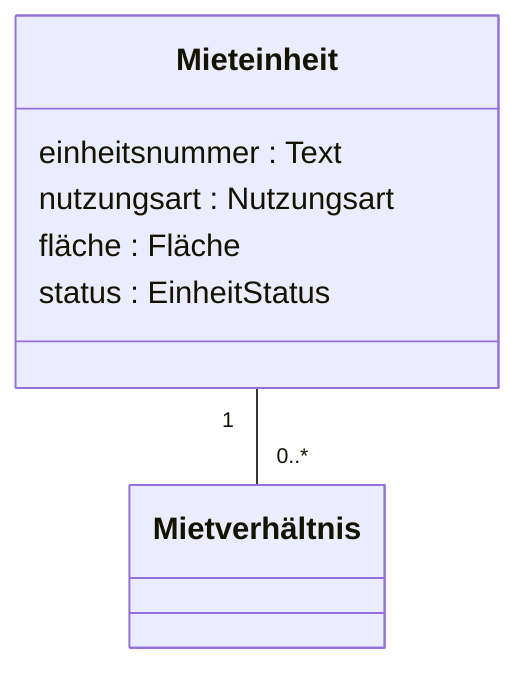

# Fachmodell ImmoVerwalt (Ist-Modell)

Technologieunabhängiges Modell des Altsystems – abgeleitet aus Code und Regelkatalog.
Keine Begriffe aus PHP, Doctrine, Symfony oder der Oberfläche; noch keine aus Java oder Spring.

## Klassendiagramm

## Konzepte

| Konzept | Beschreibung | Fundstelle im Altsystem |
|---|---|---|
| Mieteinheit | Wohnung oder Gewerbeeinheit in einem Gebäude | `src/Entity/RentalUnit.php` |
| | | |

## Aufzählungen und Zustände

| Aufzählung | Werte | Bemerkung |
|---|---|---|
| EinheitStatus | verfügbar, reserviert, vermietet, gekündigt, Renovierung, gesperrt | im Code als Zeichenkette |
| | | |

## Regeln

Verweis auf die Einträge in `regelkatalog.md` (z. B. REGEL-01), jeweils mit dem betroffenen Konzept.

| Regel | betrifft |
|---|---|
| REGEL-01 | Mieteinheit, Mietverhältnis |
| | |

## Offene Fragen an den Fachbereich

- 
