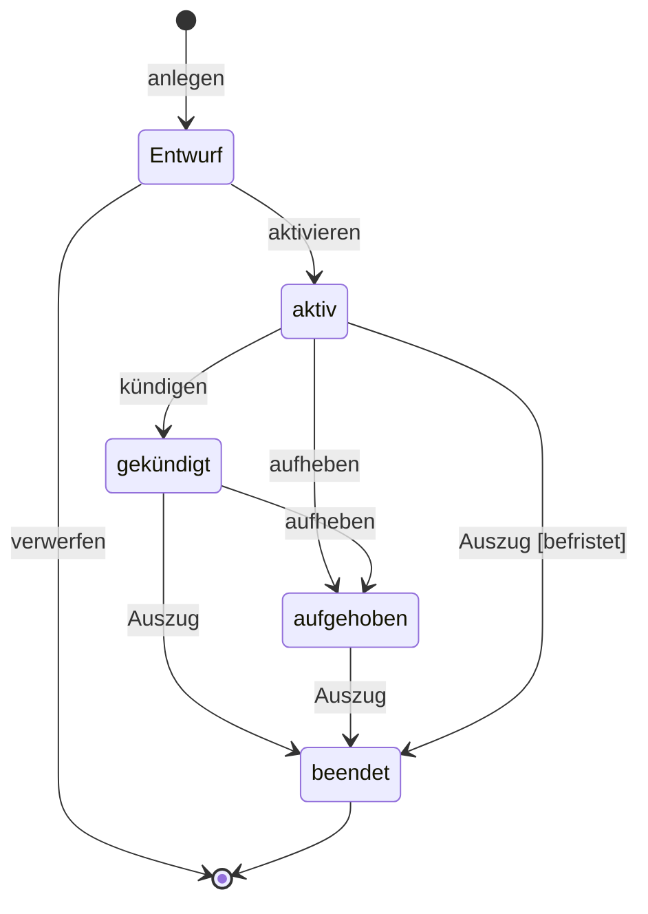
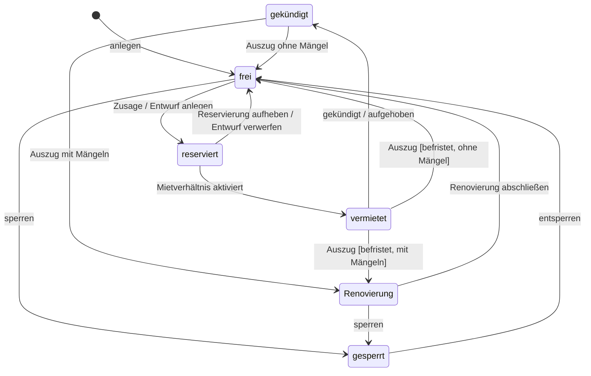
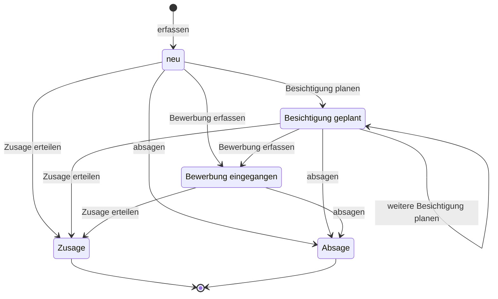
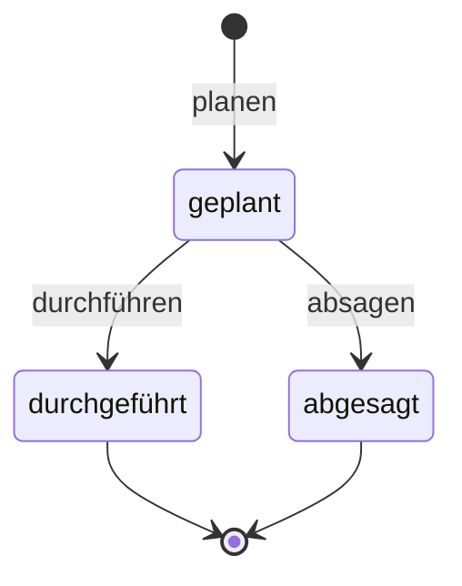
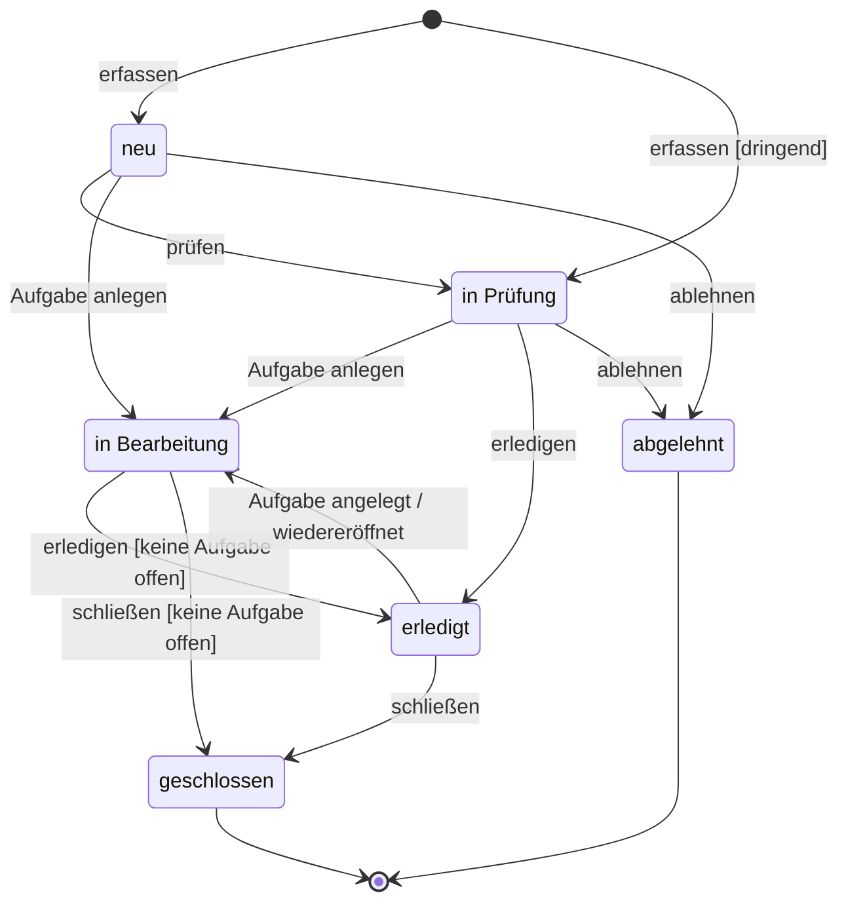
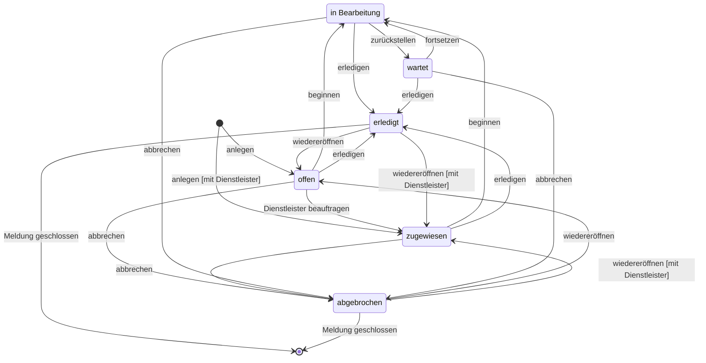
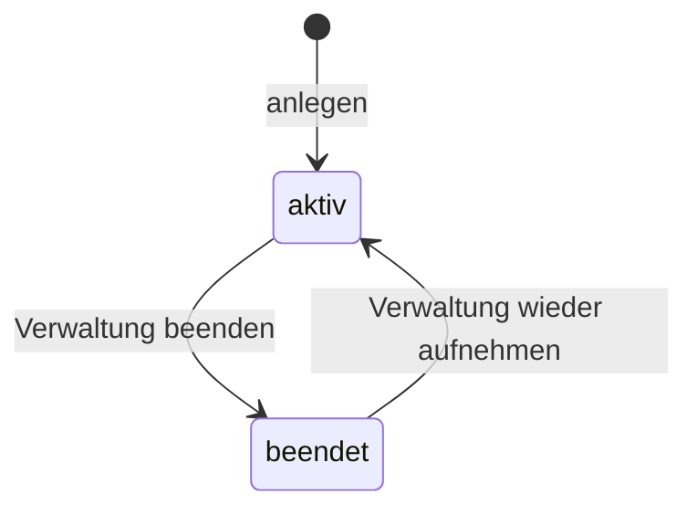

# Verhalten ImmoVerwalt

Zustände und Übergänge der Entities mit Lebenszyklus in den Pflichtbereichen (Leitfaden Schritt 6).
Dass sich ein Status nur über die hier beschriebenen Übergänge ändert, ist REGEL-34.
Begriffe nach [glossar.md](./glossar.md), Entities und Aufzählungen nach
[fachmodell.md](./fachmodell.md). Entscheidungen stehen im [Logbuch](./logbuch.md).

## Vorgehen

Eingabe waren nicht nur die beiden Befehle aus dem Leitfaden, sondern alle Stellen, an denen sich ein
Status ändern kann:

```
grep -n "const " src/Entity/*.php                        # Statuswerte
grep -rn "setStatus(" src --include=*.php                # Übergänge in Ablauf und Diensten
grep -rn "'status'" src/Form                             # Status frei im Formular wählbar
grep -rn "status ==\|status in\|status !=" templates     # Bedingungen nur in der Oberfläche
```

Jeder Fall erscheint je Entity in zwei Teilen:

1. **Ist (Altsystem):** jeder gefundene Übergang mit Fundstelle. *Prüfung* sagt, wo die Bedingung
   geprüft wird: in der Fachlogik, nur in der Oberfläche (Button wird ausgeblendet; ein direkter
   Aufruf umgeht das) oder gar nicht.
2. **Modell:** die fachlich erlaubten Übergänge als Tabelle und Zustandsdiagramm. Abweichungen vom
   Altsystem stehen als **Befund** mit Entscheidung darunter.

Zustandsnamen nach dem Glossar; Code-Werte stehen nur in der Fundstelle. Entities ohne Lebenszyklus
(Eigentümer, Gebäude, Mieter, Dienstleister, Übergabe) fehlen hier. Eigentümer und Dienstleister
haben nur das Merkmal *aktiv*.

---

## Mietverhältnis

### Ist (Altsystem)

| Von | Nach | Ausgelöst durch | Bedingung | Prüfung | Fundstelle |
|---|---|---|---|---|---|
| – | Entwurf (`DRAFT`) | AF-04 Mietverhältnis als Entwurf anlegen | Mieteinheit frei oder reserviert; kein aktives Mietverhältnis der Einheit; keine überschneidende Laufzeit; Ende nicht vor Beginn. Folge: Mieteinheit reserviert | Fachlogik | `TenancyController::new()`, `TenancyService::createTenancy()` |
| Entwurf | aktiv (`ACTIVE`) | AF-06 Mietverhältnis aktivieren | Zustand Entwurf; mindestens ein Mieter. Folge: Mieteinheit vermietet, Einzugstermin, erste Sollstellung | Fachlogik | `TenancyService::activate()` |
| aktiv | gekündigt (`NOTICE_GIVEN`) | AF-07 Mietverhältnis kündigen | Zustand aktiv. Folge: Kündigungsdatum gesetzt, Ende = Kündigungsdatum + 3 Monate, Mieteinheit gekündigt, Auszugstermin | Fachlogik | `TenancyController::terminate()` |
| aktiv | aufgehoben (`TERMINATED`) | AF-08 Mietverhältnis fristlos aufheben | nur Admin. Folge: Ende = Stichtag, Mieteinheit gekündigt, Auszugstermin | nur Oberfläche | `TenancyService::terminateImmediately()`, `tenancy/show.html.twig` |
| gekündigt | aufgehoben | AF-08 | wie oben | nur Oberfläche | wie oben |
| gekündigt | beendet (`ENDED`) | AF-09 Auszug protokollieren | Übergabeart Auszug. Folge: Mieteinheit frei, bei Mängeln Renovierung | keine | `TenancyService::recordHandover()` |
| aufgehoben | beendet | AF-09 Auszug protokollieren | wie oben | keine | wie oben |
| aktiv | beendet | AF-09 Auszug protokollieren | Übergabeart Auszug im Formular gewählt; Ende = Auszugsdatum, falls leer | keine | `TenancyService::recordHandover()`, `HandoverType` (Art frei wählbar) |
| Entwurf, beendet | aufgehoben | direkter Aufruf von AF-08 | keine | keine | `TenancyService::terminateImmediately()` |
| Entwurf, beendet | beendet | direkter Aufruf von AF-09 | keine | keine | `TenancyService::recordHandover()` |

Ein protokollierter **Einzug** ändert den Zustand nicht.

### Befunde und Entscheidungen

| Nr. | Befund | Art | Entscheidung im Modell |
|---|---|---|---|
| B-01 | aktiv → beendet durch Auszug ohne Kündigung | nicht erlaubt | Nur bei **befristetem** Mietverhältnis (Laufzeit mit Ende) und Auszug frühestens zum Ende erlaubt; sonst muss vorher gekündigt oder aufgehoben werden (F-12). |
| B-02 | Aufheben ist im Ablauf nicht geprüft: Entwurf und beendetes Mietverhältnis lassen sich aufheben | nicht erlaubt | Aufheben nur aus aktiv oder gekündigt (REGEL-20). |
| B-03 | Auszug ist nicht geprüft: auch Entwurf und beendetes Mietverhältnis lassen sich „beenden“, mehrfacher Auszug möglich | nicht erlaubt | Auszug nur aus gekündigt, aufgehoben oder (B-01) aktiv; je Mietverhältnis höchstens ein Auszug. |
| B-04 | Ein Entwurf kann nicht verworfen werden; die Mieteinheit bleibt dann dauerhaft reserviert | fehlt | Neuer Übergang **verwerfen**: Entwurf → Ende des Lebenszyklus, Mieteinheit wieder frei (REGEL-31, F-11). |
| B-05 | Die Kündigungsfrist ist fest 3 Monate im Ablauf | Bedingung | Frist kommt aus dem Attribut *Kündigungsfrist* des Mietverhältnisses (fachmodell.md). |
| B-06 | Der Button „Kündigung erfassen“ fragt zusätzlich `noticeGiven` ab | Bedingung | entfällt, der Zustand allein entscheidet (REGEL-15). |

### Modell

| Von | Nach | Ausgelöst durch | Bedingung | Fundstelle |
|---|---|---|---|---|
| – | Entwurf | anlegen (AF-04) | Mieteinheit frei oder reserviert; keine Überschneidung der Laufzeit; Ende nicht vor Beginn | `TenancyService::createTenancy()` |
| Entwurf | – | verwerfen | – | neu (B-04) |
| Entwurf | aktiv | aktivieren (AF-06) | mindestens ein Mieter | `TenancyService::activate()` |
| aktiv | gekündigt | kündigen (AF-07) | Ende = Kündigungsdatum + Kündigungsfrist | `TenancyController::terminate()` |
| aktiv, gekündigt | aufgehoben | aufheben (AF-08) | nur Administration; Ende = Stichtag | `TenancyService::terminateImmediately()` |
| gekündigt, aufgehoben | beendet | Auszug (AF-09) | Übergabe der Art Auszug protokolliert | `TenancyService::recordHandover()` |
| aktiv | beendet | Auszug (AF-09) | nur wenn befristet und Auszug nicht vor dem Ende (B-01) | `TenancyService::recordHandover()` |



---

## Mieteinheit (Einheitenstatus)

Der Einheitenstatus ändert sich meist als **Folge** eines Übergangs im Mietverhältnis oder beim
Mietinteressenten (REGEL-29). Diese Übergänge sind mit „Folge von …“ gekennzeichnet.

### Ist (Altsystem)

| Von | Nach | Ausgelöst durch | Bedingung | Prüfung | Fundstelle |
|---|---|---|---|---|---|
| – | frei (`AVAILABLE`) | AF-12 Mieteinheit anlegen | Vorgabewert, im Formular änderbar | – | `RentalUnit::status`, `RentalUnitType` |
| frei | reserviert (`RESERVED`) | Folge von AF-03 Zusage | Mietinteressent hat diese Mieteinheit gewünscht | Fachlogik | `RentalService::acceptProspect()` |
| frei, reserviert | reserviert | Folge von AF-04 Entwurf anlegen | siehe Mietverhältnis | Fachlogik | `TenancyService::createTenancy()` |
| reserviert | vermietet (`RENTED`) | Folge von AF-06 aktivieren | – | Fachlogik | `TenancyService::activate()` |
| vermietet | gekündigt (`NOTICE_GIVEN`) | Folge von AF-07 kündigen oder AF-08 aufheben | – | Fachlogik | `TenancyController::terminate()`, `TenancyService::terminateImmediately()` |
| gekündigt, vermietet | frei | Folge von AF-09 Auszug | keine Mängel | keine | `TenancyService::recordHandover()` |
| gekündigt, vermietet | Renovierung (`RENOVATION`) | Folge von AF-09 Auszug | Mängel festgestellt | keine | `TenancyService::recordHandover()` |
| jeder | jeder | AF-12 Mieteinheit pflegen | keine | keine | `RentalUnitController::edit()`, `RentalUnitType` (alle sechs Werte wählbar) |

*gesperrt* (`BLOCKED`) und der Weg von *Renovierung* zurück zu *frei* gibt es nur über das Formular.

### Befunde und Entscheidungen

| Nr. | Befund | Art | Entscheidung im Modell |
|---|---|---|---|
| B-07 | Im Formular lässt sich jeder Einheitenstatus setzen, auch *vermietet* ohne Mietverhältnis oder *frei* bei aktivem Mietverhältnis | nicht erlaubt | Von Hand nur **sperren**, **entsperren** und **Renovierung abschließen**. Reserviert, vermietet und gekündigt entstehen nur als Folge der Vermietung (REGEL-29, F-17). |
| B-08 | Eine Reservierung lässt sich nicht aufheben (außer per Formular) | fehlt | Neuer Übergang reserviert → frei: Folge von „Entwurf verwerfen“ oder **Reservierung aufheben** (REGEL-31, F-14). |
| B-09 | vermietet → frei/Renovierung durch Auszug ohne Kündigung | Folge von B-01 | nur bei befristetem Mietverhältnis |
| B-10 | Ein Entwurf ist auch für eine reservierte Mieteinheit möglich, der Button aber nur bei freier Mieteinheit sichtbar | widersprüchlich | erlaubt, weil die Zusage die Einheit reserviert und danach der Entwurf folgt (REGEL-01, F-01) |

### Modell

| Von | Nach | Ausgelöst durch | Bedingung | Fundstelle |
|---|---|---|---|---|
| – | frei | anlegen (AF-12) | – | `RentalUnitController::new()` |
| frei | reserviert | Folge von Zusage oder Entwurf anlegen | – | `RentalService::acceptProspect()`, `TenancyService::createTenancy()` |
| reserviert | frei | Reservierung aufheben; Folge von Entwurf verwerfen | kein Entwurf mehr für die Mieteinheit | neu (B-08) |
| reserviert | vermietet | Folge von Mietverhältnis aktivieren | – | `TenancyService::activate()` |
| vermietet | gekündigt | Folge von kündigen oder aufheben | – | `TenancyController::terminate()`, `TenancyService::terminateImmediately()` |
| gekündigt (vermietet bei B-01) | frei | Folge von Auszug | keine Mängel | `TenancyService::recordHandover()` |
| gekündigt (vermietet bei B-01) | Renovierung | Folge von Auszug | Mängel festgestellt | `TenancyService::recordHandover()` |
| Renovierung | frei | Renovierung abschließen | – | nur Formular (B-07) |
| frei, Renovierung | gesperrt | sperren | kein Entwurf und kein aktives Mietverhältnis | nur Formular (B-07) |
| gesperrt | frei | entsperren | – | nur Formular (B-07) |



Die Mieteinheit hat keinen Endzustand: Sie bleibt im Bestand, solange die Liegenschaft verwaltet wird.

---

## Mietinteressent (Interessentenstatus)

### Ist (Altsystem)

| Von | Nach | Ausgelöst durch | Bedingung | Prüfung | Fundstelle |
|---|---|---|---|---|---|
| – | neu (`NEW`) | AF-01 Mietinteressent erfassen | Vorgabewert, im Formular änderbar | – | `Prospect::status`, `ProspectType` |
| jeder | Besichtigung geplant (`VIEWING_PLANNED`) | AF-02 Besichtigung planen | Button nur bei neu, Besichtigung geplant, Bewerbung eingegangen | nur Oberfläche | `RentalService::planViewing()`, `letting/prospects.html.twig` |
| neu, Besichtigung geplant, Bewerbung eingegangen | Zusage (`ACCEPTED`) | AF-03 Zusage erteilen | Folge: Mieter angelegt, gewünschte Mieteinheit reserviert, falls frei | nur Oberfläche | `RentalService::acceptProspect()`, `letting/prospects.html.twig` |
| jeder | jeder | AF-01 Mietinteressent pflegen | keine | keine | `LettingController::editProspect()`, `ProspectType` |

*Bewerbung eingegangen* (`APPLIED`) und *Absage* (`REJECTED`) gibt es nur über das Formular.

### Befunde und Entscheidungen

| Nr. | Befund | Art | Entscheidung im Modell |
|---|---|---|---|
| B-11 | Status im Formular frei wählbar | nicht erlaubt | nur über die Übergänge unten |
| B-12 | Bewerbung und Absage sind keine eigenen Aktionen | fehlt | eigene Übergänge **Bewerbung erfassen** und **absagen** |
| B-13 | Zusage ist im Ablauf nicht geprüft: ein zweiter Aufruf legt einen zweiten Mieter an; Besichtigung lässt sich auch nach Zusage oder Absage planen | nicht erlaubt | Zusage und Absage sind Endzustände; danach keine Übergänge mehr |

### Modell

| Von | Nach | Ausgelöst durch | Bedingung | Fundstelle |
|---|---|---|---|---|
| – | neu | erfassen (AF-01) | – | `LettingController::newProspect()` |
| neu, Besichtigung geplant | Besichtigung geplant | Besichtigung planen (AF-02) | – | `RentalService::planViewing()` |
| neu, Besichtigung geplant | Bewerbung eingegangen | Bewerbung erfassen | – | nur Formular (B-12) |
| neu, Besichtigung geplant, Bewerbung eingegangen | Zusage | Zusage erteilen (AF-03) | Folge: Mieter angelegt, Mieteinheit reserviert, falls frei | `RentalService::acceptProspect()` |
| neu, Besichtigung geplant, Bewerbung eingegangen | Absage | absagen | – | nur Formular (B-12) |



---

## Besichtigung (Besichtigungsstatus)

### Ist (Altsystem)

| Von | Nach | Ausgelöst durch | Bedingung | Prüfung | Fundstelle |
|---|---|---|---|---|---|
| – | geplant (`PLANNED`) | AF-02 Besichtigung planen | Folge: Mietinteressent „Besichtigung geplant“, Kalendertermin | – | `RentalService::planViewing()` |

*durchgeführt* (`DONE`) und *abgesagt* (`CANCELLED`) kommen nur in den Testdaten vor
(`AppFixtures`). Es gibt keine Route und kein Formularfeld, das den Besichtigungsstatus ändert.

### Befunde und Entscheidungen

| Nr. | Befund | Art | Entscheidung im Modell |
|---|---|---|---|
| B-14 | Eine Besichtigung bleibt immer geplant | fehlt | neue Übergänge **durchführen** und **absagen** |

### Modell

| Von | Nach | Ausgelöst durch | Bedingung | Fundstelle |
|---|---|---|---|---|
| – | geplant | Besichtigung planen (AF-02) | Mietinteressent weder Zusage noch Absage | `RentalService::planViewing()` |
| geplant | durchgeführt | durchführen | – | neu (B-14) |
| geplant | abgesagt | absagen | – | neu (B-14) |



---

## Meldung (Meldungsstatus)

### Ist (Altsystem)

| Von | Nach | Ausgelöst durch | Bedingung | Prüfung | Statushistorie | Fundstelle |
|---|---|---|---|---|---|---|
| – | neu (`NEW`) | AF-16 Meldung erfassen | Priorität nicht dringend | Fachlogik | ja | `IssueService::createIssue()` |
| – | in Prüfung (`IN_REVIEW`) | AF-16 Meldung erfassen | Priorität dringend | Fachlogik | ja | `IssueService::createIssue()` |
| neu, in Prüfung | in Bearbeitung (`IN_PROGRESS`) | AF-18 Aufgabe zu einer Meldung anlegen | – | Fachlogik | **nein** | `IssueService::createTaskFromIssue()` |
| jeder außer geschlossen, abgelehnt | geschlossen (`CLOSED`) | AF-19 Meldung schließen | keine Aufgabe offen (alle erledigt oder abgebrochen) | Aufgaben: Fachlogik; Zustand: nur Oberfläche | **nein** | `IssueService::closeIssue()`, `issue/show.html.twig` |
| jeder | jeder | AF-17 Meldungsstatus ändern | keine; Kommentar optional | keine | ja | `IssueController::status()` |
| jeder | jeder | AF-17 Sammeländerung | keine | keine | **nein** | `IssueController::bulk()` |

*erledigt* (`RESOLVED`) und *abgelehnt* (`REJECTED`) gibt es nur über die freie Statusänderung.
Eine Aufgabe, die über AF-21 (`task_new` mit Meldung) angelegt wird, ändert den Meldungsstatus
nicht (REGEL-07).

### Befunde und Entscheidungen

| Nr. | Befund | Art | Entscheidung im Modell |
|---|---|---|---|
| B-15 | Freie Statusänderung und Sammeländerung erlauben jeden Übergang, z. B. geschlossen → neu oder das Schließen mit offenen Aufgaben | nicht erlaubt | nur die Übergänge unten; die Sammeländerung wendet dieselben Übergänge auf jede Meldung einzeln an |
| B-16 | Schließen, Aufgabe anlegen und Sammeländerung schreiben keine Statushistorie | Nachbedingung fehlt | jeder Übergang schreibt einen Statuswechsel (REGEL-09) |
| B-17 | *erledigt* und *abgelehnt* sind keine eigenen Aktionen | fehlt | eigene Übergänge **erledigen** und **ablehnen**; Ablehnen nur mit Kommentar (REGEL-32) |
| B-18 | Aufgabe zur Meldung auf zwei Wegen, nur einer setzt „in Bearbeitung“ | widersprüchlich | jede neue Aufgabe zu einer neuen oder geprüften Meldung setzt sie in Bearbeitung (REGEL-07) |
| B-19 | Wird eine Aufgabe einer erledigten oder geschlossenen Meldung wiedereröffnet, ändert sich die Meldung nicht | fehlt | erledigt → in Bearbeitung bei neuer oder wiedereröffneter Aufgabe; eine geschlossene Meldung bleibt geschlossen, ihre Aufgaben können nicht wiedereröffnet werden (F-02) |

### Modell

Jeder Übergang schreibt einen Statuswechsel in die Statushistorie.

| Von | Nach | Ausgelöst durch | Bedingung | Fundstelle |
|---|---|---|---|---|
| – | neu | erfassen (AF-16) | Priorität nicht dringend | `IssueService::createIssue()` |
| – | in Prüfung | erfassen (AF-16) | Priorität dringend | `IssueService::createIssue()` |
| neu | in Prüfung | prüfen (AF-17) | – | `IssueController::status()` |
| neu, in Prüfung, erledigt | in Bearbeitung | Aufgabe anlegen (AF-18, AF-21) oder Aufgabe wiedereröffnet | – | `IssueService::createTaskFromIssue()` |
| in Prüfung, in Bearbeitung | erledigt | erledigen | keine Aufgabe offen (F-22) | neu (B-17) |
| in Bearbeitung, erledigt | geschlossen | schließen (AF-19) | keine Aufgabe offen | `IssueService::closeIssue()` |
| neu, in Prüfung | abgelehnt | ablehnen | Kommentar angegeben; keine Aufgabe vorhanden | neu (B-17) |



---

## Aufgabe (Aufgabenstatus)

### Ist (Altsystem)

| Von | Nach | Ausgelöst durch | Bedingung | Prüfung | Fundstelle |
|---|---|---|---|---|---|
| – | offen (`OPEN`) | AF-21 Aufgabe anlegen, AF-18 aus Meldung | kein Dienstleister | – | `Task::status`, `IssueService::createTaskFromIssue()` |
| – | zugewiesen (`ASSIGNED`) | AF-18 aus Meldung | Dienstleister mit passendem Gewerk gefunden | Fachlogik | `IssueService::createTaskFromIssue()` |
| offen | zugewiesen | AF-21 Aufgabe anlegen/pflegen | Dienstleister eingetragen; Ansprechpartner vorhanden | Fachlogik | `TaskService::save()` |
| jeder offene | erledigt (`DONE`) | AF-22 Aufgabe erledigen | Button nur bei offener Aufgabe (nicht erledigt, nicht abgebrochen) | nur Oberfläche | `TaskController::done()`, `task/edit.html.twig` |
| erledigt | offen | AF-23 Aufgabe wiedereröffnen | Begründung angegeben; Folge: Begründung mit Datum in den Notizen | Fachlogik | `TaskController::reopen()` |
| abgebrochen | offen | AF-23 Aufgabe wiedereröffnen | keine Begründung nötig | Fachlogik | `TaskController::reopen()` |
| jeder | jeder | AF-21 Aufgabe pflegen | keine | keine | `TaskController::edit()`, `TaskType` |

*in Bearbeitung* (`IN_PROGRESS`), *wartet* (`WAITING`) und *abgebrochen* (`CANCELLED`) gibt es nur
über das Formular.

### Befunde und Entscheidungen

| Nr. | Befund | Art | Entscheidung im Modell |
|---|---|---|---|
| B-20 | Status im Formular frei wählbar, z. B. erledigt ohne AF-22 oder erledigt → offen ohne Begründung | nicht erlaubt | nur die Übergänge unten (REGEL-22) |
| B-21 | Abgebrochene Aufgabe lässt sich ohne Begründung wiedereröffnen; das Wiedereröffnen ist auch für offene Aufgaben aufrufbar | widersprüchlich | Wiedereröffnen aus erledigt und abgebrochen, jeweils mit Begründung |
| B-22 | Wiedereröffnete Aufgabe mit Dienstleister ist „offen“, bis sie erneut gespeichert wird | widersprüchlich | Wiedereröffnen führt zu *zugewiesen*, wenn ein Dienstleister eingetragen ist (REGEL-23) |
| B-23 | Beginnen, Warten, Fortsetzen und Abbrechen sind keine eigenen Aktionen | fehlt | eigene Übergänge; Abbrechen nur mit Begründung (REGEL-33) |
| B-24 | Aufgaben einer geschlossenen Meldung lassen sich wiedereröffnen | nicht erlaubt | siehe B-19 |

### Modell

| Von | Nach | Ausgelöst durch | Bedingung | Fundstelle |
|---|---|---|---|---|
| – | offen | anlegen (AF-18, AF-21) | kein Dienstleister | `IssueService::createTaskFromIssue()`, `TaskService::save()` |
| – | zugewiesen | anlegen (AF-18, AF-21) | Dienstleister aktiv, Ansprechpartner vorhanden | `IssueService::createTaskFromIssue()`, `TaskService::save()` |
| offen | zugewiesen | Dienstleister beauftragen (AF-21) | Dienstleister aktiv, Ansprechpartner vorhanden | `TaskService::save()` |
| offen, zugewiesen | in Bearbeitung | beginnen | – | nur Formular (B-23) |
| in Bearbeitung | wartet | zurückstellen | – | nur Formular (B-23) |
| wartet | in Bearbeitung | fortsetzen | – | nur Formular (B-23) |
| offen, zugewiesen, in Bearbeitung, wartet | erledigt | erledigen (AF-22) | – | `TaskController::done()` |
| offen, zugewiesen, in Bearbeitung, wartet | abgebrochen | abbrechen | Begründung | nur Formular (B-23) |
| erledigt, abgebrochen | offen bzw. zugewiesen | wiedereröffnen (AF-23) | Begründung; Meldung nicht geschlossen; zugewiesen, wenn Dienstleister eingetragen | `TaskController::reopen()` |



---

## Liegenschaft (Verwaltungsstatus)

| Von | Nach | Ausgelöst durch | Bedingung | Fundstelle |
|---|---|---|---|---|
| – | aktiv | AF-10 Liegenschaft anlegen | – | `Property::status`, `PropertyType` |
| aktiv | beendet | AF-10 Liegenschaft pflegen | Altsystem: keine. Modell: kein laufendes Mietverhältnis in der Liegenschaft (REGEL-35, F-21) | `PropertyType` |
| beendet | aktiv | AF-10 Liegenschaft pflegen | – | `PropertyType` |



---

## Abhängige Übergänge

Übergänge, die einen Übergang an einer anderen Entity auslösen. Sie sind die Grundlage für die
Aggregatgrenzen in Schritt 8.

| Auslöser | Folge | Regel |
|---|---|---|
| Mietinteressent: Zusage | Mieter angelegt; Mieteinheit frei → reserviert | REGEL-25 |
| Mietinteressent: Besichtigung planen | Besichtigung geplant; Kalendertermin | – |
| Mietverhältnis: anlegen | Mieteinheit → reserviert | REGEL-29 |
| Mietverhältnis: verwerfen | Mieteinheit reserviert → frei | REGEL-29 (neu) |
| Mietverhältnis: aktivieren | Mieteinheit → vermietet; Einzugstermin; erste Sollstellung | REGEL-29 |
| Mietverhältnis: kündigen, aufheben | Mieteinheit → gekündigt; Auszugstermin | REGEL-19, REGEL-29 |
| Mietverhältnis: Auszug | Mieteinheit → frei oder Renovierung | REGEL-21, REGEL-29 |
| Aufgabe: angelegt oder wiedereröffnet | Meldung → in Bearbeitung | REGEL-07 |
| Meldung: schließen, erledigen | setzt voraus: keine Aufgabe offen | REGEL-02 |

## Prüffrage

*Hat jeder Zustand mindestens einen Weg hinein und – außer Endzuständen – einen hinaus?*

| Entity | Ergebnis im Modell | im Altsystem (ohne Formular) |
|---|---|---|
| Mietverhältnis | ja; Endzustand beendet, Entwurf kann verworfen werden | ja, aber kein Ausweg aus dem Entwurf (B-04) |
| Mieteinheit | ja; kein Endzustand | gesperrt und Renovierung → frei nur per Formular |
| Mietinteressent | ja; Endzustände Zusage und Absage | Bewerbung eingegangen und Absage nicht erreichbar (B-12) |
| Besichtigung | ja; Endzustände durchgeführt und abgesagt | geplant ohne Ausweg (B-14) |
| Meldung | ja; Endzustände geschlossen und abgelehnt | erledigt und abgelehnt nur über freie Statusänderung (B-17) |
| Aufgabe | ja; Ende mit dem Schließen der Meldung | in Bearbeitung, wartet und abgebrochen nur per Formular (B-23) |
| Liegenschaft | ja | ja |
